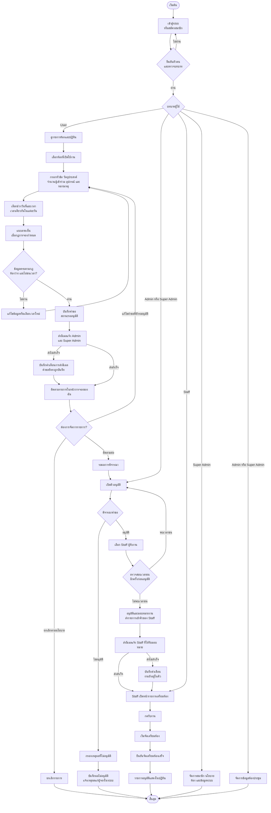

# Flowchart การใช้งานระบบ EduRoom

แผนภาพนี้สรุปลำดับการจองห้อง การพิจารณาคำขอ และการเตรียมห้องประชุม แสดงด้วย Mermaid ใน Markdown viewer ที่รองรับ Mermaid

## ลำดับงานโดยย่อ

1. ผู้ใช้เข้าสู่ระบบ เลือกห้อง วันและเวลา พร้อมกรอกรายละเอียดการใช้งานและแนบลายเซ็นเมื่อระบบกำหนด
2. ระบบตรวจความครบถ้วน กฎการจอง ความจุห้อง และเวลาที่ซ้ำซ้อนก่อนบันทึกคำขอเป็น **รออนุมัติ**
3. ระบบแจ้ง Admin และ Super Admin ทางอีเมล ผู้จองติดตามหรือแก้ไขคำขอที่ยังรออนุมัติได้ และยกเลิกได้ตามนโยบาย
4. Admin ตรวจคำขอ หากอนุมัติต้องเลือก Staff และตรวจเวลาชนก่อนส่งงาน หากไม่อนุมัติต้องระบุเหตุผล
5. Staff รับงาน เริ่มจัดเตรียม และยืนยันเมื่อเตรียมห้องเสร็จ รายการที่อนุมัติจะแสดงในปฏิทิน

> ปัจจุบันระบบส่งอีเมลเมื่อมีคำขอใหม่และเมื่ออนุมัติแล้วส่งงานให้ Staff หากการส่งอีเมลล้มเหลว ระบบยังคงบันทึกรายการและแสดงคำเตือน การแจ้งผลไม่อนุมัติแสดงเหตุผลแก่ผู้จองในระบบ
